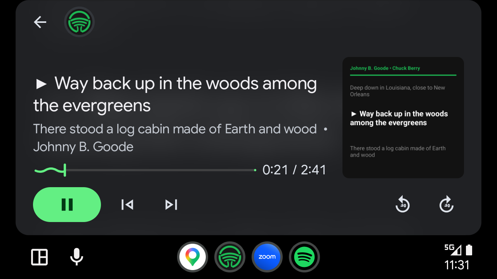
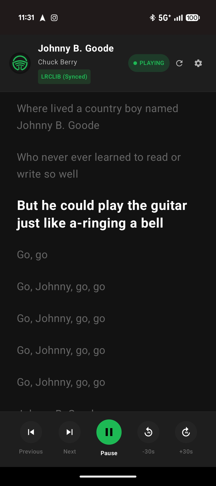

# DashLyrics for Android Auto & Android 🎵🚗

> **Glanceable, real-time synchronized lyrics for Spotify — seamlessly projected onto your vehicle's Android Auto screen and phone.**

<p align="center">
  
  &nbsp;&nbsp;&nbsp;&nbsp;
  
</p>

---

## 🌟 Highlights

- **🚗 Android Auto Native Integration**: Renders a dynamic, glanceable 3-line sliding window (`Previous`, `▶ Active`, `Up Next`) on vehicle head units via `androidx.car.app` and `MediaBrowserService`.
- **⚡ Zero-Config Passive Playback Tracking**: Listens to Spotify via Android's `MediaSessionManager` with zero manual pairing or login required.
- **🔄 Multi-Tier Synced Lyrics Cascade**:
  1. **Spotify Direct** (Official synced lyrics API via optional `sp_dc` cookie)
  2. **LRCLIB** (Aggressive 6-step synchronized search with duration matching)
  3. **Karalyr** (Open LRCLIB-compatible karaoke database)
  4. **Lyrics.ovh** (Smoothly distributed plain lyrics safety net)
- **🔍 Persistent Synced Search & Live Upgrade**: If a track begins with unsynced lyrics, DashLyrics displays the text immediately while background workers continue searching across all sources, smoothly upgrading to time-synced auto-scroll the moment timestamps are found.
- **⏱️ Instant Transport & Precision Seeking**: Full playback control bar (`Previous | Next | Play/Pause | -30s | +30s`) with optimistic position locking.
- **🛡️ Driver Safety First**: Full-screen safety modal upon app activation, persistent amber safety warnings, and Android Auto passenger-use disclaimers.

---

## 📸 Screenshots

| Android Auto Vehicle Display | Android Phone App |
| :---: | :---: |
|  |  |
| *Real-time 3-line lyrics projected onto car head unit* | *Jetpack Compose auto-scrolling lyrics with ±30s controls* |

---

## ⚠️ Driver Safety Warning

> **Passenger & Safely Parked Use Only**:
> Do not read lyrics or interact with this app while operating a motor vehicle. Distracted driving is dangerous and illegal. Always maintain complete focus on the road.

---

## 🏗️ Architecture

- **Language:** Kotlin 1.9+
- **UI Frameworks:** Jetpack Compose (Phone) & `androidx.car.app:app:1.4.0` (Android Auto)
- **Audio & Media:** Android `NotificationListenerService`, `MediaBrowserService`, `MediaSession`
- **Network:** OkHttp 4 + `kotlinx.serialization`
- **Target SDK:** Android 14 (API 34) • **Min SDK:** Android 8.0 (API 26)

---

## 🚀 Building & Installing

### Prerequisites
- Android Studio Hedgehog / Iguana or later
- Android SDK 34 & JDK 17

### 1. Build Debug APK
```bash
./gradlew assembleDebug
```

### 2. Enable "Unknown sources" in Android Auto (One-Time Setup)
Because this app is sideloaded (not yet installed from the Google Play Store), Android Auto's package validator requires **Unknown sources** to be enabled:
1. On your phone, open **Settings > Connected devices > Connection preferences > Android Auto** (or search "Android Auto" in Settings).
2. Scroll to the very bottom to **Version** and tap it **10 times** until a prompt asks to enable Developer Settings.
3. Tap the **3-dot menu** in the top-right corner > **Developer settings**.
4. Check **Unknown sources**.
5. Set **Application Mode** to **Developer**.

### 3. Sideload to Phone for Android Auto
Install the APK to your phone via ADB:
```bash
adb install -i com.android.vending -r app/build/outputs/apk/debug/app-debug.apk
```

### 4. Grant Notification Listener Permission
1. Open **DashLyrics** on your phone.
2. Tap the **Grant** button on the notification permission banner (or navigate to `Settings > Apps > Special app access > Notification access`).
3. Enable **DashLyrics**.
4. Play any song on **Spotify** — lyrics will sync and project automatically!

---

## 📄 License
MIT License.
